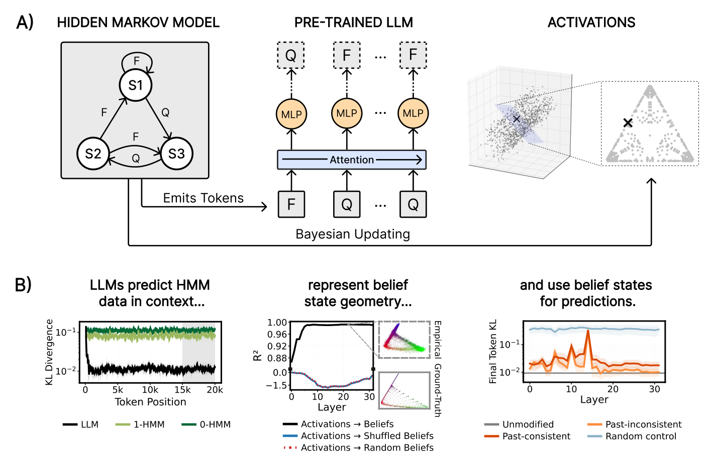

# Large Language Models Develop Belief State Geometry In-Context

[](https://neurips.cc/) [](https://arxiv.org/abs/2609.17376)

Daniel Balcells\*, Andrew Jun Lee\*, Chirag Rastogi\*, Paul M. Riechers, Adam Shai, and Xavier Poncini†

\*These authors contributed equally and are listed alphabetically.

†Correspondence to xponcini@gmail.com.

This repository contains the code, the figures, and the analysis notebooks behind the paper, published at NeurIPS 2026 and available on arXiv as [arXiv:2609.17376](https://arxiv.org/abs/2609.17376).

## Abstract

Large language models (LLMs) trained on next-token prediction exhibit remarkable in-context learning (ICL) abilities, yet the representations that support ICL remain poorly understood. We consider such representations in a controlled setting: prompting LLMs with data emitted from hidden Markov models (HMMs) and probing for the corresponding belief state—the posterior distribution over the HMM's hidden states given the observed token history. Across six open-source LLMs prompted with data from 40 HMMs selected for non-trivial belief structure, we find that belief states are linearly decodable from residual stream activations, with peak probe R²-values of 0.83–0.99 across HMM and LLM combinations, ranging from early to late layers. To establish functional relevance, we intervene directly on the probe-identified subspace via patching and steering, resulting in downstream prediction quality on the order of the untampered model, while controls degrade performance substantially. Together, these results provide representation-level evidence that ICL in open-source LLMs approximates optimal Bayesian prediction over a context-inferred generative model. More broadly, our findings extend prior results linking input-distribution structure to activation geometry: from toy networks trained explicitly on HMM data to production-scale LLMs.



**Figure 1: HMMs induce belief state geometry in LLMs.** (a) An HMM (left) emits tokens by transitioning between hidden states (S1, S2, S3). Conditioning on this sequence in-context, an LLM (middle) predicts the next token. Computational mechanics suggests that optimal prediction requires tracking the belief state—the posterior over the HMM's hidden states—whose reachable set traces a characteristic geometry in the activation space (right). (b) Results preview for one HMM (Wing). The LLM predicts near-optimally in-context (left), linear probes recover the belief geometry far beyond controls (middle), and intervening on the belief subspace influences the predictions (right).

## Setup

```bash
pip install torch transformers accelerate numpy pandas scikit-learn scipy numba tqdm matplotlib seaborn jupyter huggingface_hub sentencepiece protobuf
export HF_HOME=/path/to/model/cache
export HF_TOKEN=hf_...          # required for Llama
```

## Replicating Results

All figures of the paper are saved in `figures/`. Table 3 and the ranges of Table 2 are printed by the notebooks.

To reproduce a part of the paper:
- Run the "runner" script in `scripts/` that executes all experiments of that part, and saves the results files to `results/`.
- Then, open and run the corresponding notebook to load those files, and generate and save the figures to `figures/`.

All runner scripts and notebooks:

1. **Section 4.** `bash scripts/run_prediction.sh`, then `notebooks/01_prediction.ipynb` (Figures 2, 8, 9, 23, and 29 to 40, and the ranges of Table 2).
2. **Section 5 and Appendix F.** `bash scripts/run_probes.sh`, then `notebooks/02_probes.ipynb` (Figures 3, 4, 5, 10 to 14, 24 to 26, 41 to 46, and 59 to 76, and Table 3).
3. **Section 6.** `bash scripts/run_interventions.sh`, then `notebooks/03_interventions.ipynb` (Figures 6, 7, 22, 27, 28, and 77 to 100).
4. **Appendix H.** `bash scripts/run_tuned_lens.sh`, then `notebooks/04_tuned_lens.ipynb` (Figures 15 to 21 and 47 to 58).

The three panels of Figure 1 (b) come from the first three notebooks. Edit the flags in the runner scripts to change the settings. Run a script with `--help` to see the defaults and allowed values.

Compute is listed in Appendix B of the paper. On one GPU with 32 to 96 GB of memory, a single model needs roughly one GPU-hour per prediction, probe, or tuned-lens script, 20 to 40 GPU-hours for the belief-steering script, and 0.7 to 1.8 GPU-hours per HMM family for the prediction-intervention script.

## Directories

The repository has seven directories.

- `src/`: shared functions
  - `hmm/definitions.py`: the transition matrices of the four HMM families and their order-1 and order-0 approximations
  - `hmm/core.py`: stationary distributions, sequence sampling, belief states, next-token probabilities, and k-suffix beliefs
  - `metrics/probes.py`: the least-squares probes with a bias term
  - `metrics/kl.py`: the KL divergence
  - `model_utils.py`: model loading, prompt formatting, position matching, activation extraction, and the full-vocabulary KL
- `configs/`
  - `hmm_configs.py`: the 40 HMMs (four families with ten parametrizations each) and the representative parametrization of each family
- `experiments/`
  - Explained below
- `scripts/`
  - Explained above
- `notebooks/`: create figures
  - `01_prediction.ipynb`, `02_probes.ipynb`, `03_interventions.ipynb`, `04_tuned_lens.ipynb`
- `figures/`
  - Location of figures from `notebooks/`. Figures are included in repository.
- `results/`
  - Location of saved outputs from `experiments/`. Empty in repository. Email to request data, if you would not like to generate them.

## Experiments

All experiments share the following experimental design:

1. Sample a 20,000-token sequence from the HMM and compute the exact Bayesian belief state at every position.
2. Write the sequence as space-separated single letters and run the model once with the whole sequence as context.
3. Keep the final 5,000-token window, where the model's predictions have converged.
4. Where a probe is involved, fit OLS on a random 20 percent of that window and score the probe by R² on the other 80 percent, with the split seeded by the sequence seed.

We describe each experiment file below. All files save results in `results/`.

### Section 4. In-context prediction accuracy

How well do the models predict HMM data at all?

- **Filename.** `experiments/prediction/run_kl.py`
- **Explanation.** At every position, compute the KL divergence from the HMM's next-token probabilities to the model's, over the full vocabulary.
- **Saved Outputs.** `kl_<model>.csv`
- **Corresponding Figures.** Figure 2, the left panel of Figure 1 (b), Figure 23, and Figures 29 to 40.

### Section 5. Linear probes for the belief state

How well are belief states linearly decodable from activations?

#### Belief-state probes and geometries

- **Filename.** `experiments/probes/run_belief_probes.py`
- **Explanation.** At every layer, fit probes from the activations to the belief state, with shuffled-belief and random-belief controls. At each parametrization's best layer, record the decoded geometries for the (1) held-out test set, pooled over the ten sequences, (2) probes fit to all 5,000 final positions, and (3) the two controls.
- **Saved Output.** `r2_<model>.csv`, `geom_<model>.npz`, `geompool_all_<model>.npz`, `geompool_insample_<model>.npz`, and `geompool_ctl_<model>.npz`
- **Corresponding Figures.** Figure 3, the middle panel of Figure 1 (b), Figures 10 to 13, Figure 24, and Figures 41 to 46.

#### NTP and log-NTP probes

- **Filename.** `experiments/probes/run_ntp_probes.py`
- **Explanation.** At every layer, fit probes from the activations to the next-token probabilities (NTP) and to the log next-token probabilities (log-NTP), and fit the model-free baselines that regress the belief state on the ground-truth NTP and log-NTP.
- **Saved Output.** `ntp_probes_<model>.csv`
- **Corresponding Figures.** The right panels of Figure 5, the bottom of Figure 26, and Figures 71 to 76.

#### k-suffix probes

- **Filename.** `experiments/probes/run_ksuffix_probes.py`
- **Explanation.** For k from 1 to 20, fit probes to the belief computed from only the last k tokens, using activations on sequences from the full HMM, from its order-1 approximation, and from its order-0 approximation.
- **Saved Output.** `ksuffix_probes_<model>.csv`
- **Corresponding Figures.** The left panels of Figure 5, the top of Figure 26, and Figures 65 to 70.

#### Transfer probes

- **Filename.** `experiments/probes/run_transfer_probes.py`
- **Explanation.** For every pair of parametrizations within a family, train a probe on one parametrization's activations to decode the other's belief states on the same sequence, and do the same for ground-truth beliefs.
- **Saved Output.** `transfer_probes_<model>.csv` and `transfer_probes_gt_<model>.csv`
- **Corresponding Figures.** Figures 4 and 25 and Figures 59 to 64.

#### Early-context probes

- **Filename.** `experiments/probes/run_early_context_probes.py`
- **Explanation.** At each parametrization's best layer from the belief-probe results, fit probes on 1,000 random positions among the first 5,000 tokens and store their predictions on the remaining early positions.
- **Saved Output.** `early_context/early_context_<model>__<family>__<param>.npz`
- **Corresponding Figures.** Figure 14.

#### Contiguous-split and held-out-sequence probes (Appendix F)

- **Filename.** `experiments/probes/run_contiguous_split_probes.py` and `experiments/probes/run_heldout_sequence_probes.py`
- **Explanation.** Refit the belief-state probes under two protocols that keep the test positions away from the training positions: train on the first 20 percent of the window (positions 15,000 to 16,000) and test on the rest, and train on one sequence's training positions and test on all 5,000 window positions of the next sequence, cycling over the 10 sequences. The peak-layer R² is compared with that of the random split.
- **Saved Output.** `contiguous_split_probes_<model>.csv` and `heldout_sequence_probes_<model>.csv`
- **Corresponding Table.** Table 3.

### Section 6. Intervening on the belief state subspace

Do interventions on the belief-probe subspace propagate to (a) the log-NTP representations of later layers and (b) the output distribution of the model?

#### (a) Steering the belief state and decoding later layers

- **Filename.** `experiments/interventions/run_belief_steering.py`
- **Explanation.** Steer the belief-probe subspace at one layer over the last 5,000 positions toward a donor belief, then decode the belief, the NTP, the log-NTP, and the belief's NTP-invisible component at every later layer, using probes fit before the steer. The three donors are `past_inconsistent` (another sequence's beliefs), `ntp_matched` (a move along the kernel direction of the emission matrix, which changes the belief but not the NTP), and `random_matched` (a random direction with the same norms).
- **Saved Output.** `belief_steering_<donor>_<model>.csv`
- **Corresponding Figures.** Figures 6, 22, and 27, Figures 77 to 82, and Figures 89 to 100.

#### (b) Patching and steering the prediction

- **Filename.** `experiments/interventions/run_prediction_interventions.py`
- **Explanation.** Patch or steer the belief subspace at the last k positions of the full sequence, for k of 1, 5, and 10, and measure the KL divergence from the injected belief's next-token probabilities to the model's prediction, next to the KL from the original belief's and to a random-belief control.
- **Saved Output.** `prediction_interventions_<model>.csv`
- **Corresponding Figures.** Figure 7, the right panel of Figure 1 (b), Figure 28, and Figures 83 to 88.

### Appendix H. The tuned lens

Are the layers where beliefs are decodable also the layers from which the prediction can be read out early?

- **Filename.** `experiments/tuned_lens/run_tuned_lens.py`
- **Explanation.** Per layer, train an affine lens toward the HMM's next-token probabilities, toward shuffled, random, order-1, and cross-parametrization control targets, and toward the model's own output, and score every lens, together with the untrained logit lens, by the KL to its target on held-out positions.
- **Saved Output.** `tunedlens_<model>.csv`
- **Corresponding Figures.** Figure 15, Figures 16 to 21, and Figures 47 to 58.

## Figures

Below is a list of the figures that each notebook generates from the saved outputs in `results/`.

- `01_prediction.ipynb`
  - Figure 2: `kl_mess3_wing.pdf`
  - Figure 23: `kl.pdf`
  - Figure 1 (b), left panel: `fig1_kl_wing.svg`
  - Figures 8 and 9 and the ranges of Table 2: `belief_geometry.pdf` and `all_lambda2_vs_entropy.pdf`
  - Figures 29 to 34: `kl_all_<model>.png`
  - Figures 35 to 40: `crossover_hist_<model>.pdf`
- `02_probes.ipynb`
  - Figure 3: `r2_pooled_mess3_wing.pdf`
  - Figure 24: `r2_pooled.pdf`
  - Figure 1 (b), middle panel: `fig1_r2_wing.svg`
  - Figures 10 to 14: `geometry_grid_real_pooled_qwen35_9b.pdf`, `geometry_grid_insample_pooled_qwen35_9b.pdf`, `geometry_grid_shuffle_pooled_qwen35_9b.pdf`, `geometry_grid_random_pooled_qwen35_9b.pdf`, and `geometry_grid_early_5k_first250_pooled_qwen35_9b.pdf`
  - Figures 41 to 46: `r2_controls_<model>.pdf`
  - Figure 4: `within_r2_mess3_wing.pdf`
  - Figure 25 and Figures 59 to 64: `within_r2.pdf` and `within_r2_<model>.pdf`
  - Figure 5 (its Mess3 and Wing panels), Figure 26 (top), and Figures 65 to 70: `redr2.pdf`, `rep_gap_k20_<model>.pdf`, and `rep_gap_theory_seed_<model>.pdf`
  - Figure 5 (its Mess3 and Wing panels), Figure 26 (bottom), and Figures 71 to 76: `obsprob.pdf`, `ntp_gap_<model>.pdf`, `log_ntp_gap_<model>.pdf`, `ntp_gap_theory_seed_ntp_<model>.pdf`, and `ntp_gap_theory_seed_log_ntp_<model>.pdf`
- `03_interventions.ipynb`
  - Figures 6 and 27: `xmap_dtarget_logntp_after_frozen_qwen35_9b_rsplit.pdf`
  - Figure 22: `ker_dtarget_hidden_after_qwen35_9b_rsplit.pdf` and `randdir_dtarget_qwen35_9b_rsplit.pdf`
  - Figures 77 to 82, 89 to 94, and 95 to 100: `xmap_summary_rawR2_<model>_rsplit.pdf`, `ker_summary_rawR2_<model>_rsplit.pdf`, and `randdir_summary_rawR2_<model>_rsplit.pdf`
  - Figure 7: `intervene_main_patch_steer_k10_mess3_wing.pdf`
  - Figure 28: `intervene_main_patch.pdf` and `intervene_main_steer.pdf`
  - Figure 1 (b), right panel: `fig1_intervene_wing.svg`
  - Figures 83 to 88: `intervene_all_<model>.pdf`
- `04_tuned_lens.ipynb`
  - Figure 15: `tunedlens.pdf`
  - Figures 16 to 21, bottom panels: `tuned_concept_corr_<model>.pdf`
  - Figures 47 to 52: `tunedlens_all_<model>.pdf`
  - Figures 53 to 58: `tunedlens_corr_slope_<model>.pdf`

## Citation

```bibtex
@inproceedings{balcells2026belief,
  title     = {Large Language Models Develop Belief State Geometry In-Context},
  author    = {Balcells, Daniel and Lee, Andrew Jun and Rastogi, Chirag and Riechers, Paul M. and Shai, Adam and Poncini, Xavier},
  booktitle = {Advances in Neural Information Processing Systems},
  year      = {2026}
}
```
